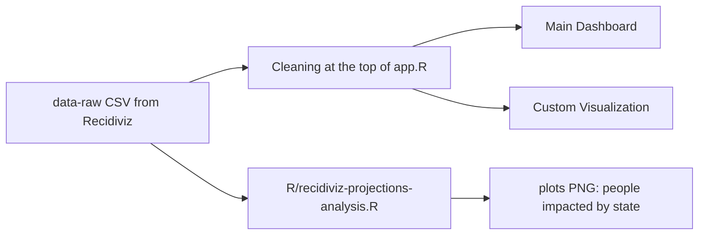

# Recidiviz Impact Projections Dashboard

An R Shiny dashboard and the data behind it: projections that Recidiviz, an organization that models criminal justice policy, produced for REFORM Alliance. The projections estimate how many people a set of recent state probation and supervision laws affect. REFORM Alliance uses them to understand its pathways to getting 1,000,000 people off probation.

**Live app:** <https://bfs6-recidiviz-projections.share.connect.posit.cloud/>

## What the data is

Each row of `data-raw/recidiviz-projections-total.csv` is one **bill**, for one **type of reform**, at one **time frame**. The file has 48 rows covering 12 states (California, Florida, Georgia, Illinois, Louisiana, Maryland, Michigan, Mississippi, New Jersey, New York, Pennsylvania and Virginia) and 22 bills that were passed between 2020 and 2025. One of those bills (Virginia HB 1589) has no figures yet.

| Column | What it holds |
| --- | --- |
| `State`, `Bill Name`, `Year Passed` | The law being modeled. |
| `Impact type` | The kind of reform: **Reduced supervision time** (21 rows), **Reduced incarceration time** (13), **Modified supervision conditions** (12) or **Record expungement** (1). A bill can appear under more than one type. |
| `Estimate time frame` | `Sep-25` is the estimate as of September 2025. `ten years` is the ten-year projection. The dashboard shows the second as "10-Year". |
| `Life-years` | The first measure, with a `lower CI` and `upper CI` range beside it. Recidiviz's public description of its policy-impact modeling frames life-years as years given back to people who avoid incarceration or supervision. |
| `People impacted` | The second measure, with its own `lower CI` and `upper CI`. |
| `modelability score` | A 0 to 4 score from Recidiviz for each estimate. The repo does not hold Recidiviz's definition of the levels, so confirm it with them before quoting it. The dashboard leaves this column out of its tables. |

About half the rows have a low and high range. Rows without one show a single estimate.

## Read the numbers carefully

- **Totals are plain sums.** The dashboard's state bars and `plots/state_viz_by_estimate_time.png` add up the rows. Adding every "people impacted" figure in the September 2025 column across the 11 states that have one gives about 1.36 million. That is not the number of people off probation. The rows mix reform types, including shorter incarceration and record expungement, and the code does nothing to stop one person being counted under two bills. Use the **Reform Type** filter, and ask Recidiviz how to combine bills, before quoting a total.
- **Some rows are incomplete.**

| Bill | What is missing |
| --- | --- |
| Mississippi SB 2795 | No life-years. A September 2025 figure for people impacted only (9,339), with a modelability score of 0. |
| Maryland SB 432 (record expungement) | Ten-year only, and no life-years. It does not appear when the dashboard is set to September 2025. |
| Virginia SB 936 / HB 2252 | Ten-year only. |
| California AB 3234 (reduced incarceration time) | People impacted only, no life-years. |
| Virginia HB 1589 | No figures at all. The dashboard drops it because its time frame is blank. |

## What the dashboard does

- **Main Dashboard.** Filters on the left for projection timeframe, reform type, state, bill and measure (people impacted by default; life-years is the alternative). A bar chart adds the matching rows by state, and a table underneath lists them with buttons to copy, download (CSV, Excel, PDF) or print. Choosing a state narrows the bill list.
- **Custom Visualization.** Pick a chart type (bar, line, scatterplot or boxplot), what to group by, up to two things to split the chart by, and filters. Click **Generate Plot**. **Download Data** saves the filtered rows as a CSV. The table underneath lists the same rows.
- The bar chart shows the point estimate only. The low and high ranges appear in the tables.
- No database, login or secret is used. Everything comes from the one CSV file in the repo.

The cleaning step removes the thousands separators, gives the two pairs of `lower CI` / `upper CI` columns separate names, turns the file into one row per measure (life-years or people impacted), drops rows with a blank time frame and renames "ten years" to "10-Year". The analysis script repeats the same cleaning and draws one chart, a single stacked bar of September 2025 people impacted by state, saved to `plots/`.

## Repository layout

| File or folder | What it is |
| --- | --- |
| `app.R` | The whole dashboard: packages, data cleaning, page layout and server logic. |
| `data-raw/recidiviz-projections-total.csv` | The Recidiviz projections. This is the file the dashboard reads. |
| `R/recidiviz-projections-analysis.R` | A stand-alone script that makes the PNG in `plots/`. The dashboard does not use it. |
| `plots/state_viz_by_estimate_time.png` | The saved chart. |
| `data/recidiviz-projections-clean.csv` | A saved long-format copy of the data. Neither the dashboard nor the script reads it. See Known issues. |
| `renv.lock`, `renv/`, `.Rprofile` | Pinned package versions. `.Rprofile` switches renv on when the project opens. |
| `manifest.json` | The R version and package list that Posit Connect Cloud builds the app from. |
| `recidiviz-projections.Rproj` | The RStudio project file. The code finds `data-raw/` relative to it. |

The pinned version is R 4.5.0 with the packages in `renv.lock`.

## Update the data

1. Replace `data-raw/recidiviz-projections-total.csv` with the new file from Recidiviz. **Keep the column order and the header row.** The file has two columns called `lower CI` and two called `upper CI`, and the code tells them apart by position (the first pair belongs to life-years, the second to people impacted).
2. The code renames `ten years` to "10-Year". Any other time frame label, such as `Sep-25` or a new `Sep-26`, appears in the filters exactly as written, so spell it the same way on every row.
3. Type numbers with or without commas. Leave a cell empty (or write `NA`) where Recidiviz gave no figure.
4. Run the dashboard locally and click through the filters.
5. To refresh the PNG, open the project in RStudio and run `R/recidiviz-projections-analysis.R`. It writes to `plots/`. The title and the label it filters on say "September 2025", so edit both if the date changes.
6. Follow **Publish an update** below.

## Run it locally

1. Install R 4.5.0 and the RStudio desktop app.
2. Clone or download this repo and double-click `recidiviz-projections.Rproj`. RStudio opens the project and renv switches on by itself.
3. In the R console, run `renv::restore()` once. It installs the pinned package versions.
4. Open `app.R` and click **Run App**, or run `shiny::runApp()` in the console.

The first start downloads US state boundaries from the Census Bureau, so it needs an internet connection and takes a moment.

## Publish

This dashboard is hosted on [Posit Connect Cloud](https://connect.posit.cloud). The live app is at <https://bfs6-recidiviz-projections.share.connect.posit.cloud/>. Connect Cloud copies the code from GitHub and builds the app itself, so publishing an update means getting the change onto the GitHub branch it follows (normally `main`; **Settings > Source** in Connect Cloud shows which). Nothing is uploaded from your computer. Addresses have the form `https://<account>-<custom name>.share.connect.posit.cloud`. This one uses the account name `bfs6`, the same as REFORM's other dashboards.

### Publish an update

1. Make and test the change on your computer.
2. If you added or upgraded an R package, run `renv::snapshot()` and then `rsconnect::writeManifest()` in the R console, and commit both `renv.lock` and `manifest.json`. Connect Cloud reads `manifest.json` for the package list, so a stale one gives the live app the wrong packages or fails the build.
3. Commit and push to `main`, or merge a pull request into it. "Automatically publish on push" is on by default, so Connect Cloud rebuilds and redeploys the app at the same address.
4. Open the live address and click through the Main Dashboard filters and the Custom Visualization tab.
5. If the live app did not change, sign in to Connect Cloud, open the app's card and look at the publish log for an error. **Republish** on the card redeploys from the latest code on GitHub.

### Publish for the first time, or re-create the app

1. Run `rsconnect::writeManifest()` in the R console. Commit and push `app.R`, `manifest.json` and `data-raw/`.
2. Sign in to [Connect Cloud](https://connect.posit.cloud) with the account named `bfs6`, which owns the `share.connect.posit.cloud` addresses.
3. Click **Publish** at the top of your Home page. The first time, Connect Cloud asks you to install its GitHub App; give it access to this repository. A repo owned by the REFORM-Alliance organization may need an organization owner to approve the app.
4. Choose **Shiny**, then select this repository.
5. Confirm the **Branch** is `main` and the **Primary file** is `app.R`. Leave **Automatically publish on push** on.
6. Click **Publish** and watch the build log.
7. Open the app's **Settings > URL** and set the custom name to `recidiviz-projections`. The address becomes `https://bfs6-recidiviz-projections.share.connect.posit.cloud`.
8. Open the address in a private browser window to check that someone who is not signed in to Connect Cloud can use it.

### If something goes wrong

- **The repository is missing from the Publish list.** Connect Cloud's GitHub App does not have access to it. Give the app access in GitHub, then reload the list.
- **Free accounts can publish only public repositories.** If this repository is ever made private, the account needs a paid plan.
- **The build fails after a package change.** Run `rsconnect::writeManifest()` again, commit `manifest.json` and push.
- **No secrets to set.** `app.R` reads no environment variables, so nothing is needed under Advanced settings.

## Known issues

Found by reading the code and checking the data files; the app was not run. Confirm each before changing anything.

- **Download Plot fails.** The button's code calls `custom_plot()`, which is not defined anywhere in `app.R`, so a click should give an error instead of a PNG.
- **The opening filter does not match the data.** The Projection Timeframe filter starts with "September 2025" selected, but the data calls it `Sep-25`, so it appears nothing is pre-selected and the first chart shows both time frames. Check this in the running app, then change the starting value in `app.R` to `Sep-25`, or relabel the column in the CSV.
- **Custom Visualization mixes the two measures.** It has no Estimate Type filter, so its chart and its **Download Data** file hold life-years and people-impacted rows together. The Main Dashboard filters by measure.
- **The start-up map download is unused.** `app.R` downloads state boundaries and defines a map, but the page never shows it. Removing both would speed up start-up and drop the need for internet access.
- **`manifest.json` is out of date.** It lists a file called `app2.R` that is not in the repo, and its recorded checksums for `app.R`, the raw CSV, the analysis script and the PNG no longer match. Run `rsconnect::writeManifest()` and commit the result before the next publish.
- **`data/recidiviz-projections-clean.csv` is stale.** It matches the raw CSV apart from the time-frame label (`September 2025` rather than `Sep-25`) and Mississippi SB 2795, which it still shows with a blank reform type and time frame. Nothing in the repo writes or reads it. Delete it, or regenerate it, so no one quotes old figures from it.

## Sources

- [Recidiviz: Announcing Spark](https://www.recidiviz.org/updates/announcing-spark), Recidiviz's description of its impact modeling, including how it uses the term life-years.